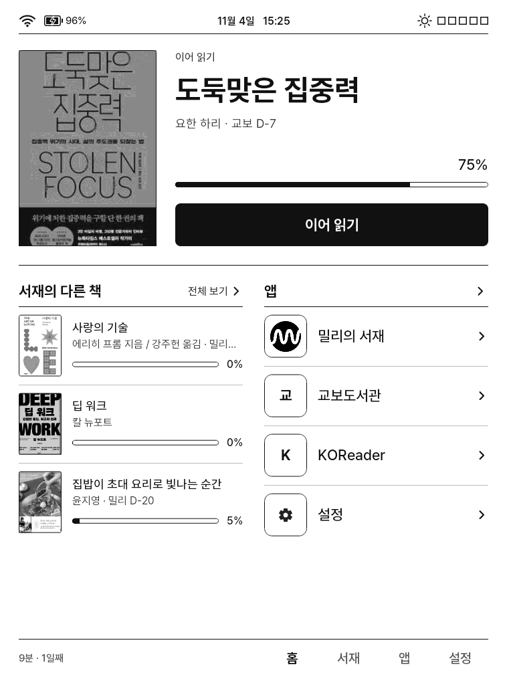
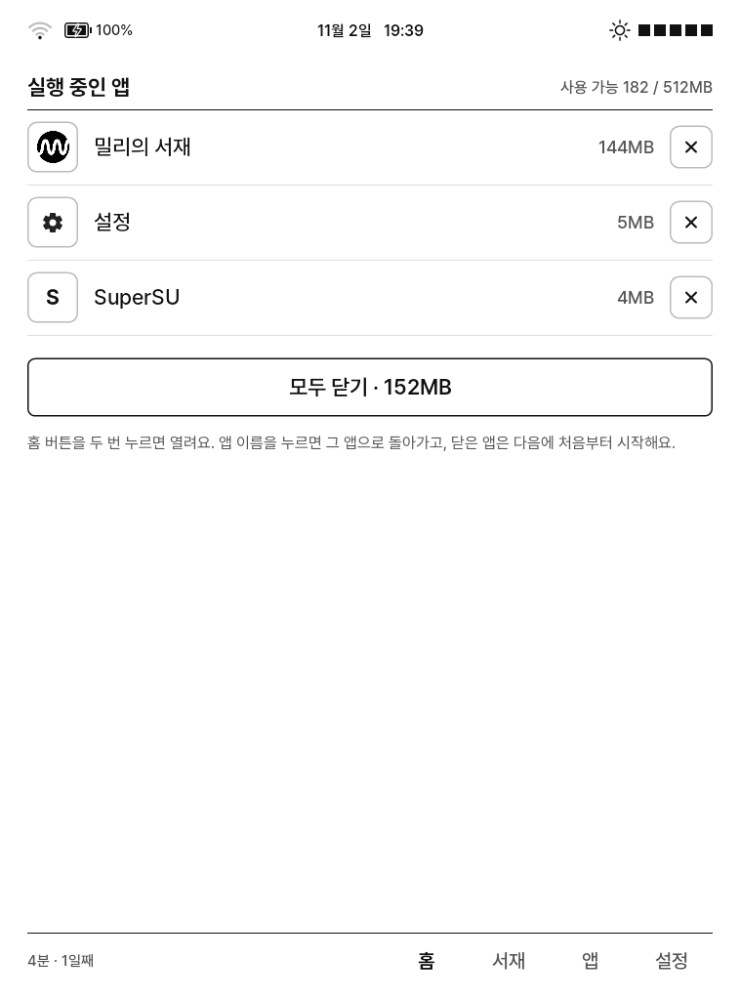
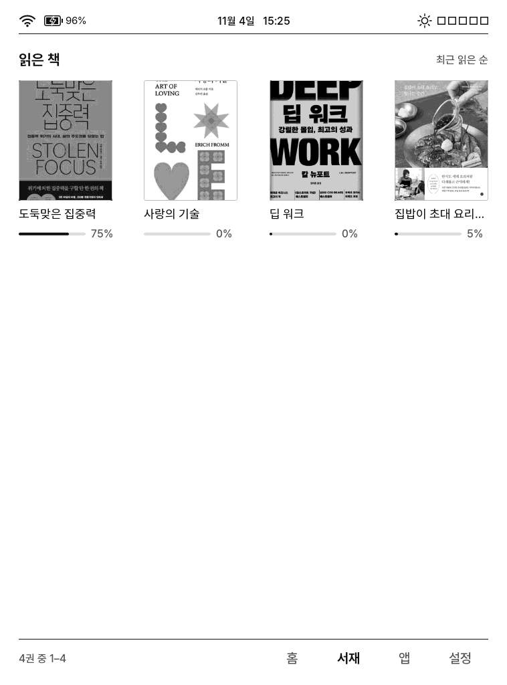
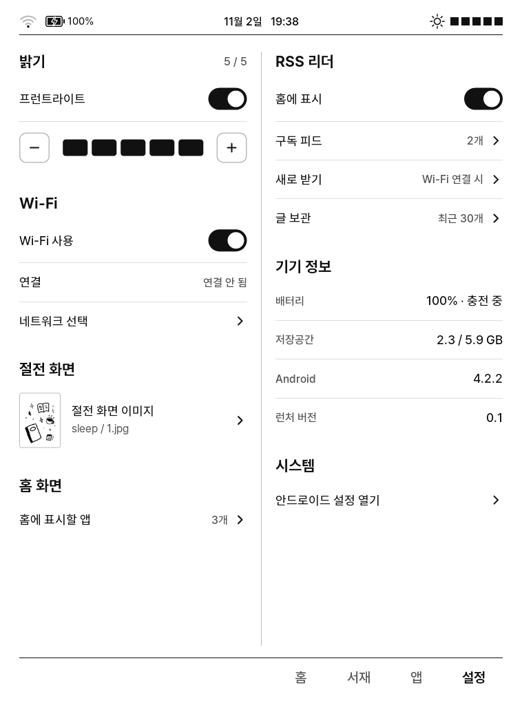
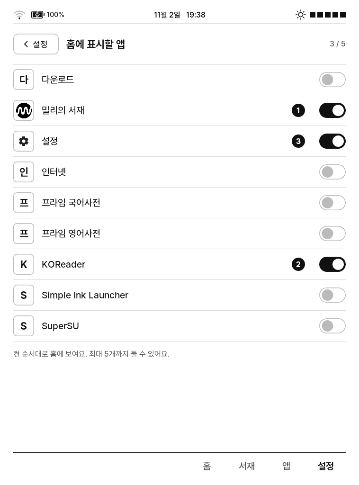

# 설치 가이드

CREMA-0640L에 millie-crema-kit을 적용하는 절차. 밀리의 서재 실행 환경과 크레마 홈 런처를 설치한다.

 

## 주의 사항

- 기기 시스템 파일을 변경한다. 설치 스크립트가 백업과 복원 스크립트를 생성하지만, 문제 발생 시 책임은 사용자에게 있다.
- 본인 계정으로 구매·구독한 콘텐츠 열람 목적이다. DRM과 구독 처리는 변경하지 않는다.
- 소요 시간: 준비 약 30분, 설치 10~20분(첫 부팅 수 분 포함).

## 다운로드

| 항목 | 링크 | 비고 |
|---|---|---|
| millie-crema-kit | `git clone https://github.com/KimWash/millie-crema-kit.git` | 이 저장소 |
| 밀리의서재 E-ink 뷰어 | [공식 다운로드 페이지 (E-ink 뷰어)](https://www.millie.co.kr/v3/customer/download?nav_hidden=y#elink) | 현재 배포 버전은 v2.14.2.0(Android 6.0 이상). 이 키트는 **2.4.0.0** 기준이며 2.14.2.0은 검증하지 않음 |
| 밀리 E-ink 이용 가이드 | [PDF](https://apis.millie.co.kr/v1/download/guide/eink-guide_210201.pdf) | 밀리 공식 |
| 밀리 E-ink 슬립 화면 | [ZIP](https://install.millie.co.kr/e-ink/sleep-image_210203.zip) | 밀리 공식. 압축을 풀어 기기의 `sleep` 폴더에 넣으면 절전 화면으로 사용 |
| KOReader 2023.06.1 (arm) | [APK 직접 받기](https://github.com/koreader/koreader/releases/download/v2023.06.1/koreader-android-arm-v2023.06.1.apk) · [릴리스 페이지](https://github.com/koreader/koreader/releases/tag/v2023.06.1) | Android 4.2를 지원하는 마지막 버전. 이후 버전은 설치 불가 |

밀리 2.4.0.0 APK는 공식 페이지에서 더 이상 제공하지 않는다. 이미 2.4.0.0이 설치된 기기가 있으면 다음과 같이 추출한다.

```bash
adb pull $(adb shell pm path kr.co.millie.eink | tr -d '\r' | sed 's/package://') Millie-2.4.0.0.apk
```

## 준비물

| 항목 | 내용 |
|---|---|
| 기기 | CREMA-0640L (Android 4.2.2). 다른 모델은 미검증 |
| 루트 권한 | 필요. [루팅](#루팅) 참고 |
| 케이블 | 데이터 전송 가능한 USB 케이블 |
| PC | macOS 또는 Linux |
| 밀리 APK | 2.4.0.0. [다운로드](#다운로드) 참고 |
| 배터리 | 50% 이상, 충전기 연결 권장 |

## PC 환경 준비

macOS 기준. [Homebrew](https://brew.sh) 필요.

```bash
brew install --cask android-platform-tools temurin
```

```bash
brew install --cask android-commandlinetools
```

```bash
sdkmanager "build-tools;34.0.0" "platforms;android-17"
```

| 패키지 | 용도 |
|---|---|
| android-platform-tools | `adb` |
| temurin | JDK (패치·앱 빌드) |
| build-tools, platforms;android-17 | APK 빌드 도구 |

```bash
git clone https://github.com/KimWash/millie-crema-kit.git
```

```bash
cd millie-crema-kit
```

## 루팅

- 이미 루팅된 경우 생략.
- adbd를 root로 실행할 수 있는 기기는 설치 스크립트로 루팅할 수 있다. SuperSU 설치 zip이 필요하다.
  ```bash
  ./install.sh --root --su-zip SuperSU.zip
  ```
- 위 방법이 동작하지 않으면 CREMA-0640L 루팅 관련 자료를 참고해 먼저 루팅한다.

## 기기 연결

1. 설정 → 태블릿 정보(기기 정보) → 빌드 번호를 7회 누른다.
2. 설정 → 개발자 옵션 → USB 디버깅을 켠다.
3. USB로 연결하고, 기기의 "USB 디버깅 허용" 창에서 "항상 허용"을 선택한다.
4. 연결을 확인한다.
   ```bash
   adb devices
   ```
   상태가 `device`이면 정상. `unauthorized`이면 3번을 다시 확인한다.

## 설치

밀리 APK를 저장소 폴더에 `Millie-2.4.0.0.apk`로 두고 실행한다.

```bash
./install.sh --all --debloat --apk Millie-2.4.0.0.apk --install-millie
```

항목을 선택하려면 `./install.sh`만 실행한다. 질문에 Enter를 누르면 기본값이 적용된다.

| 항목 | 내용 |
|---|---|
| framework, core, system | 밀리 실행에 필요한 시스템 패치 |
| wrap, webcompat | EPUB·PDF 보기, 검색 |
| launcher | 밀리 래퍼 앱("밀리의 서재" 아이콘) |
| crema-home | 홈 런처 |
| debloat | 미사용 YES24·CREMA 기본 앱 비활성화 |

설치가 끝나면 기기가 재부팅된다. 시스템 변경 후 첫 부팅은 전체 앱 최적화로 수 분이 걸린다. 부팅이 완료되면 스크립트가 밀리를 설치하고 `done`을 출력한다.

## 홈 런처 설정

1. 기기 앞면 버튼(홈)을 누른다.
2. 앱 선택 창에서 "크레마 홈"을 한 번 누르고 "항상"을 누른다. 같은 항목을 두 번 누르면 "이번만"으로 처리된다.

## 밀리의 서재 로그인

1. 크레마 홈에서 "밀리의 서재"를 누른다.
2. Wi-Fi 연결 중이면 "인터넷 연결 확인 중" 화면이 표시되고, 연결되면 자동으로 넘어간다.
3. 계정으로 로그인한다.

첫 책 열기는 시간이 걸린다.

## KOReader 설치 (선택)

크레마 홈의 이어 읽기와 서재는 KOReader 읽기 기록을 표시한다. 밀리의 서재 책은 표시되지 않는다.

```bash
curl -LO https://github.com/koreader/koreader/releases/download/v2023.06.1/koreader-android-arm-v2023.06.1.apk
```

```bash
adb install koreader-android-arm-v2023.06.1.apk
```

## 교보도서관 설치 (선택)

교보전자도서관 앱(도서관 대출 전자책). 루팅과 아래 파일이 필요하다. 파일은 e북카페(cafe.naver.com/ebook) 글에서 받는다.

| 파일 | 출처 |
|---|---|
| `KyoboLibrary_1.2.0_patched_by_salmonpa_260929.apk` | 연어파님 글 958057 (검색 API·웹방화벽 수정판) |
| `crema-soundup-CREMA0660L-v1.0.44-system-by-jecrits-*.img` | 제크리님 글 946020 (브리지 바이너리만 추출해 사용) |

1. 브리지 추출과 설치
   ```bash
   kyobo-bridge/extract.sh ~/Downloads/crema-soundup-CREMA0660L-v1.0.44-system-by-jecrits-20260706.img
   ```
   ```bash
   kyobo-bridge/setup.sh
   ```
2. 앱 빌드와 설치 (기존 교보 앱이 있으면 먼저 삭제)
   ```bash
   kyobo-compat/build.sh ~/Downloads/KyoboLibrary_1.2.0_patched_by_salmonpa_260929.apk
   ```
   ```bash
   adb install -r kyobo-compat/out/KyoboLibrary_1.2.0_crema.apk
   ```
3. 앱 설치 후 브리지를 다시 적용한다(앱 uid 반영).
   ```bash
   kyobo-bridge/setup.sh
   ```
4. 교보도서관 실행 → "업데이트" 안내가 나오면 **계속사용** → 도서관 검색 → 로그인.

도서관 사이트에서 `certificate signed by unknown authority`가 표시되면 해당 사이트의 루트 인증서가 기기에 없는 것이다. [kyobo-bridge/README.md](kyobo-bridge/README.md#루트-인증서) 참고.

### 크레마 홈에 밀리 서재 표시 (선택)

교보 책은 교보 앱을 한 번 실행하면 자동으로 크레마 홈 서재에 나온다. 밀리 책을 표시하려면 다음을 실행한다.

```bash
crema-home/shelf-sync/setup.sh
```

## 크레마 홈 사용법

| 홈 | 서재 | 설정 |
|:---:|:---:|:---:|
|  |  |  |

| 동작 | 결과 |
|---|---|
| 하단 홈 / 서재 / 앱 / 설정 | 화면 전환 |
| "N쪽부터 이어 읽기" | KOReader에서 읽던 책 열기 |
| 서재·앱에서 좌우 스와이프 | 페이지 이동 |
| 홈 버튼 두 번 | 실행 중인 앱 목록: 메모리 확인, 전환, 종료 |
| 설정 → 밝기 | 프런트라이트 켜기/끄기, 5단계 |
| 설정 → 홈 화면 → 홈에 표시할 앱 | 홈 앱 최대 5개, 켠 순서대로 표시 |

| 홈 앱 선택 | 실행 중인 앱 |
|:---:|:---:|
|  |  |

## 문제 해결

| 증상 | 조치 |
|---|---|
| 밀리가 로딩만 반복 | 홈 버튼 두 번 → 밀리의 ✕로 종료 후 다시 실행. 최초 1회 SuperSU 권한 요청은 허용 |
| Wi-Fi 연결 상태인데 밀리가 인터넷 연결을 계속 대기 | 휴대폰 핫스팟에서 주로 발생. 아이폰은 설정 → 개인용 핫스팟 화면을 연 상태로 두고 "호환성 최대화"를 켠다. 계속되면 핫스팟을 껐다 켠다 |
| 절전 후 Wi-Fi가 다시 연결되지 않음 | `adb shell su -c "settings put global wifi_sleep_policy 2"`. 핫스팟 대신 USB로 연결하려면 [usb-net](usb-net/README.md) |
| 교보: 책 검색·다운로드가 "연결이 원활하지 않습니다" | Wi-Fi(또는 usb-net) 연결 확인. `kyobo-bridge/setup.sh` 재실행 |
| 화면 잔상 | 탭을 전환하면 전체 갱신된다 |
| 부트루프 | 부팅 중 `adb devices`에 기기가 보이면 [복원](#복원) 실행 |

`com.android.location.fused`(위치 서비스)를 비활성화하면 Android 4.2에서 부트루프가 발생한다. 기본 앱을 직접 비활성화할 때 제외한다.

## 복원

설치 때마다 기기에 복원 스크립트가 생성된다.

```bash
adb shell ls /sdcard/millie-crema-backup/
```

```bash
adb shell su -c "sh /sdcard/millie-crema-backup/<시각>/restore.sh"
```

```bash
adb reboot
```

크레마 홈만 제거:

```bash
adb uninstall kr.co.crema.home
```

기술 상세는 [README.md](README.md)와 각 디렉터리의 README 참고.
