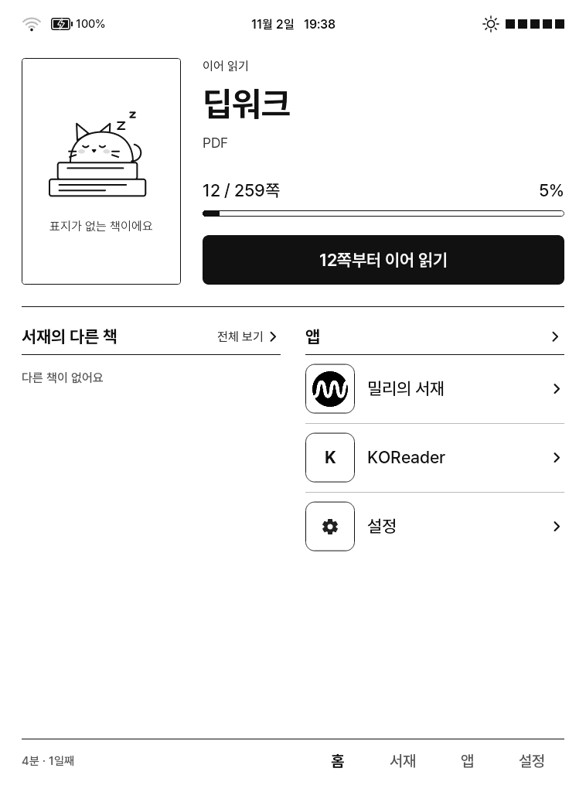
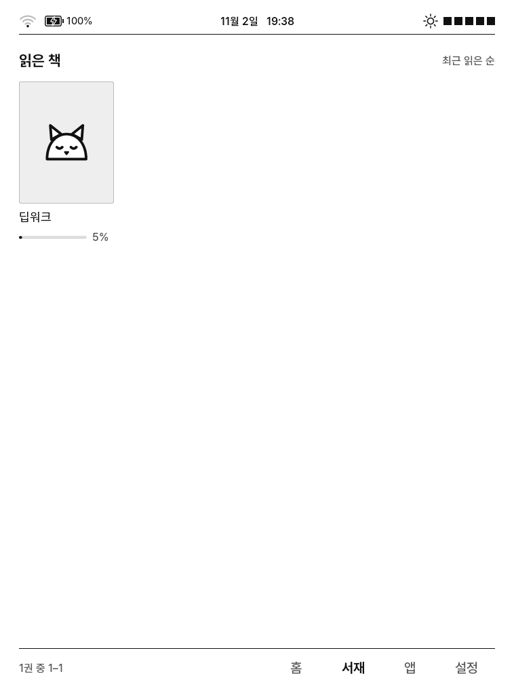
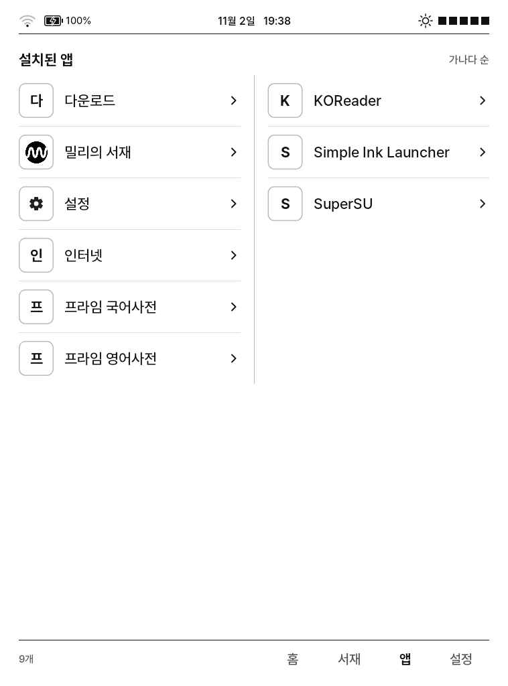
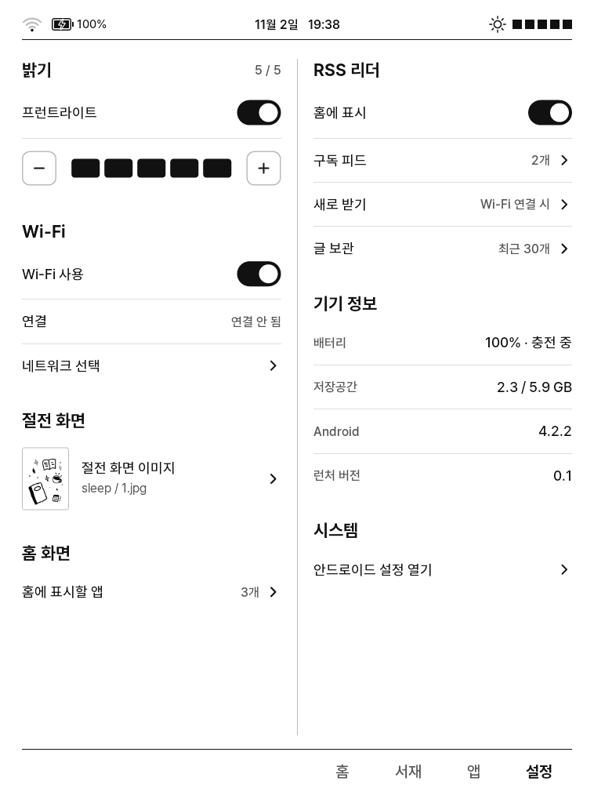
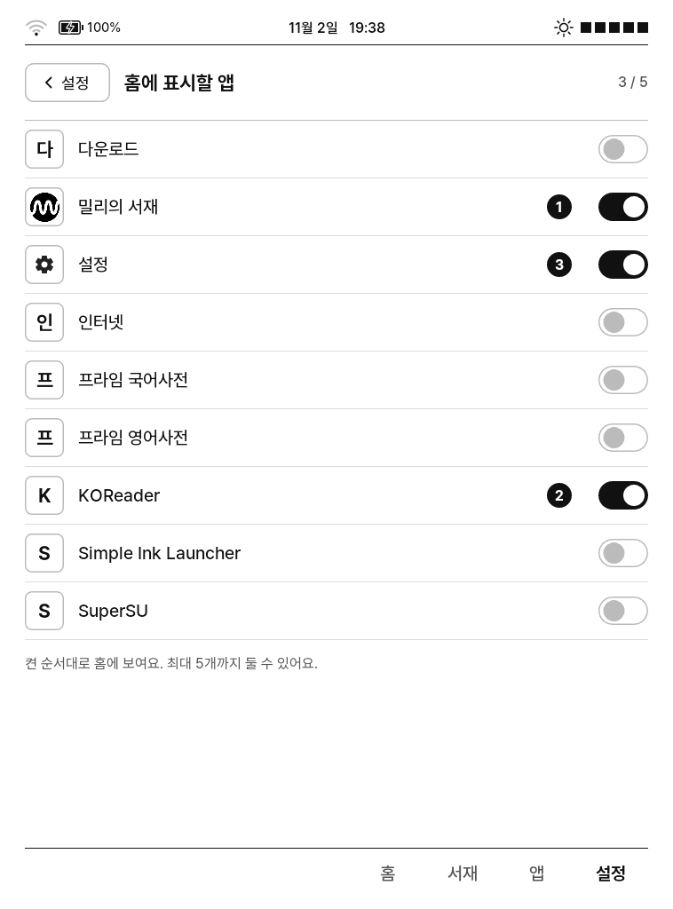
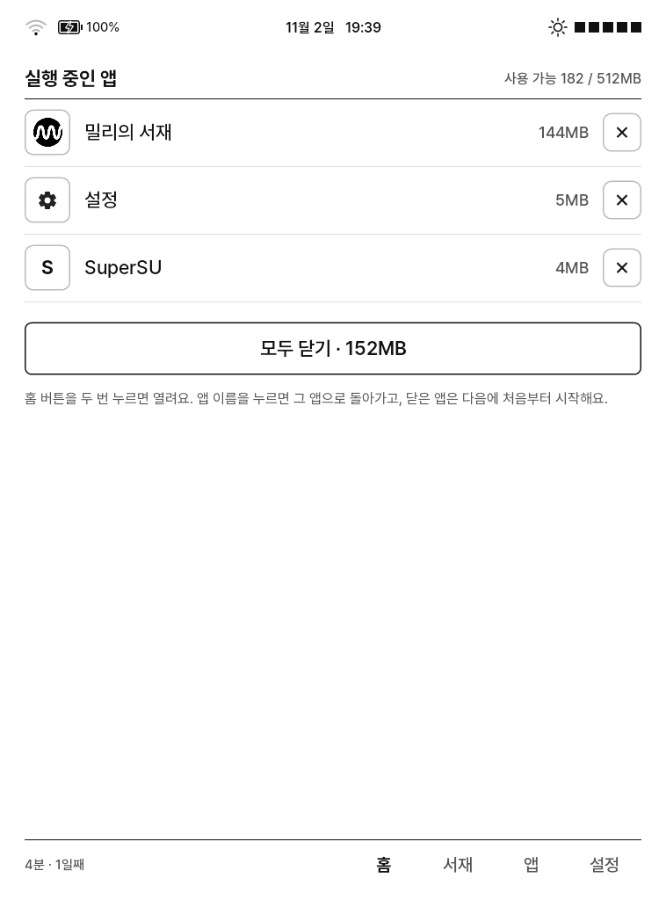

# millie-crema-kit

크레마 카르타(CREMA-0640L, Android 4.2.2)에서 밀리의 서재 2.4.0.0을 실행하기 위한 시스템 패치, 밀리 실행용 래퍼 앱, 전자잉크용 홈 런처와 설치 스크립트.

설치 절차는 [GUIDE.md](GUIDE.md) 참고.

| 홈 | 서재 | 앱 |
|:---:|:---:|:---:|
|  |  |  |
| **설정** | **홈 앱 선택** | **실행 중인 앱 (홈 버튼 두 번)** |
|  |  |  |

CREMA-0640L 실기기 화면 캡처(758×1024).

## 개요

| 항목 | 내용 |
|---|---|
| 대상 기기 | CREMA-0640L (Rockchip RK3026, RAM 512MB, 758×1024 전자잉크, Android 4.2.2 / API 17) |
| 대상 앱 | 밀리의 서재 `kr.co.millie.eink` 2.4.0.0 (minSdk 19) |
| 방식 | 앱 APK는 수정하지 않고 기기 시스템(framework.jar, core.jar, 설정 파일)을 패치 |

배경:
- 밀리 2.4.0.0은 Android 4.4(API 19) 이상을 요구한다. 4.2에서는 설치가 거부되고, 설치해도 실행 중에 4.4 API 호출로 종료된다.
- 밀리 서버는 TLS 1.2와 AES-GCM만 허용한다. Android 4.2 기본 설정은 TLS 1.0과 CBC 암호만 사용한다.
- 기본 홈(YES24)은 서비스가 종료되어 사용할 수 없다.

## 구성 요소

| 디렉터리 | 내용 |
|---|---|
| [`millie-compat/`](millie-compat/) | 시스템 패치. API 18/19 역이식, TLS 1.2·GCM, WebView `evaluateJavascript` 브리지, PDF·WebView용 LD_PRELOAD shim, 성능 설정 |
| [`millie-launcher/`](millie-launcher/) | 밀리 실행용 래퍼 앱. 멈추는 스플래시를 건너뛰고 LoginActivity를 직접 실행, 네트워크 대기, 종료된 프로세스의 태스크 정리 |
| [`crema-home/`](crema-home/) | 홈 런처. KOReader 읽기 기록·서재, 프런트라이트·Wi-Fi 설정, 실행 중인 앱 관리 |
| `install.sh` | 설치 스크립트. 항목 선택, 기기 백업과 복원 스크립트 생성 |
| `scripts/common.sh` | 공용 셸 함수 |

## 동작 범위

- 로그인, 서재, 다운로드, EPUB·PDF 보기, 검색
- 밀리 APK 미수정, DRM·구독 처리는 앱의 기존 모듈이 그대로 수행
- 밀리의 로고·아이콘·코드는 저장소에 포함하지 않음. 런처 로고는 빌드 시 사용자 APK에서 추출(`--apk`), 크레마 홈은 설치된 앱의 아이콘을 실행 시 사용

측정값(크레마 홈): APK 약 1.36MB, 메모리 약 8MB(PSS), 콜드 스타트 약 0.43초.

## 요구 사항

- 루팅된 CREMA-0640L, USB 디버깅
- macOS 또는 Linux, JDK 8 이상, Android SDK(build-tools, platforms)
- 밀리의 서재 2.4.0.0 APK (선택: 로고 추출, 설치)

## 설치

```
./install.sh                                                    # 대화형
./install.sh --all --apk Millie-2.4.0.0.apk --install-millie
./install.sh --crema-home
./install.sh --dry-run ...                                      # 기기 변경 없이 생성될 스크립트만 출력
```

| 옵션 | 내용 | 디렉터리 |
|---|---|---|
| `--root` | su, SuperSU 설치 | — |
| `--framework` | 패치된 framework.jar | millie-compat |
| `--core` | 패치된 core.jar (TLS 1.2, GCM, SHA-256 서명 검증) | millie-compat |
| `--system` | platform.xml 저장소 권한, 밀리 DRM 네이티브 라이브러리 | millie-compat |
| `--wrap` | 밀리 전용 프로세스 래퍼와 shim | millie-compat |
| `--webcompat` | EPUB 뷰어 호환 설정 | millie-compat |
| `--browser-tls` | 기본 브라우저 TLS 1.2 | millie-compat |
| `--launcher` | 밀리 래퍼 앱 | millie-launcher |
| `--crema-home` | 홈 런처 | crema-home |
| `--debloat` | 미사용 YES24·CREMA 기본 앱 비활성화 | — |

## 복원

설치 시 기기에 `/sdcard/millie-crema-backup/<시각>/restore.sh`가 생성된다.

```
adb shell su -c "sh /sdcard/millie-crema-backup/<시각>/restore.sh" && adb reboot
```

`com.android.location.fused`를 비활성화하면 Android 4.2에서 system_server가 종료되어 부트루프가 발생한다. `--debloat` 목록에서 제외되어 있다.

## 알려진 문제

- 책을 연 직후 앱 내부 JSON 처리로 30~45초 지연 (앱 코드)
- PDF의 R/B 채널이 바뀌어 표시됨
- EPUB 사용 후 PDF를 열면 메모리 부족으로 프로세스가 종료되는 경우가 있음
- 휴대폰 핫스팟 사용 시 절전 해제 후 연결 상태로 표시되지만 데이터가 전달되지 않는 경우가 있음

## 디렉터리 구조

```
install.sh
scripts/common.sh
millie-compat/
millie-launcher/
crema-home/
GUIDE.md
```
