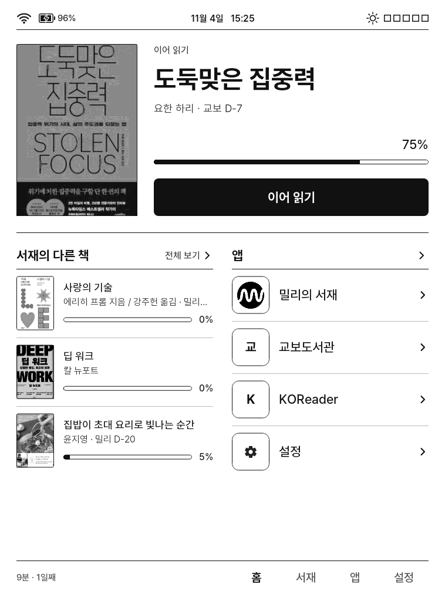
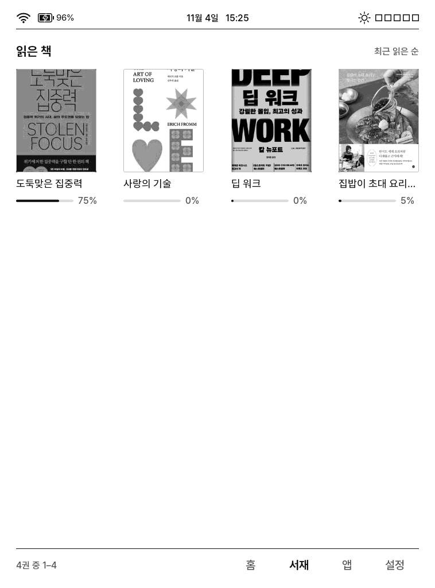
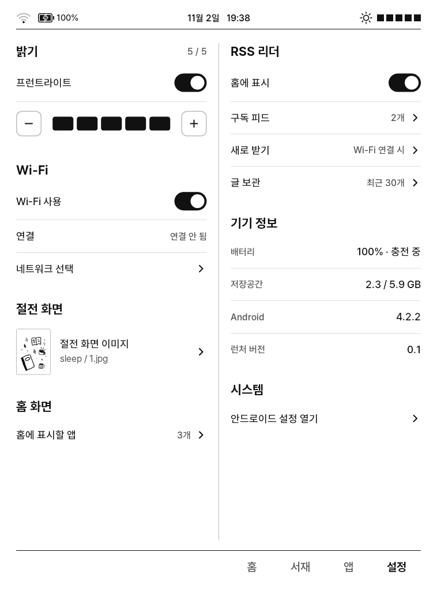
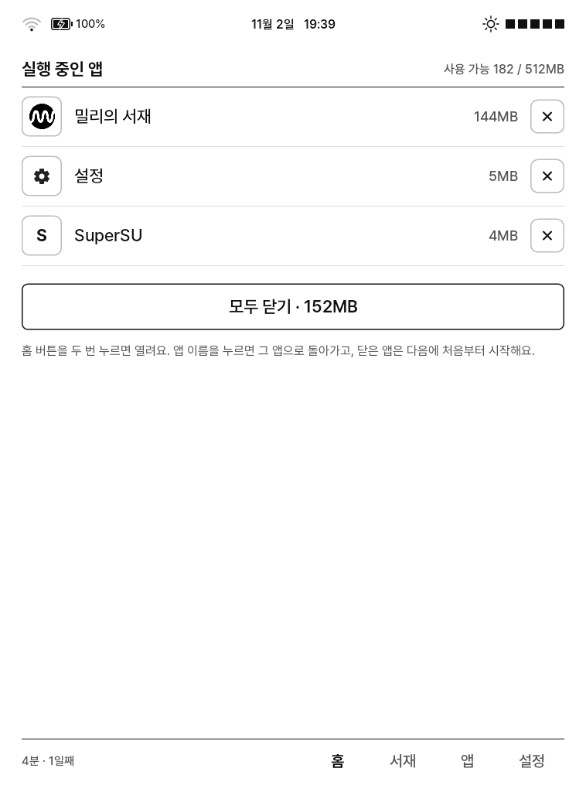

# crema-home

CREMA-0640L(758×1024 전자잉크, RAM 512MB, Android 4.2.2)용 홈 런처. 패키지 `kr.co.crema.home`.

APK 약 1.36MB, 메모리 약 8MB(PSS), 콜드 스타트 약 0.43초.

## 화면 구성

| 홈 | 서재 | 설정 | 실행 중인 앱 |
|:---:|:---:|:---:|:---:|
|  |  |  |  |

| 탭 | 내용 |
|---|---|
| 홈 | 이어 읽기(표지, 쪽수, 진행률), 서재의 다른 책 3권, 홈 앱(최대 5개) |
| 서재 | KOReader·교보도서관·밀리의 서재 책을 최근 읽은 순으로 4×3 격자, 페이지 단위 이동. 선택 시 해당 앱에서 실행 |
| 앱 | 설치된 앱 전체, 가나다 순, 2열 × 6행 |
| 설정 | 프런트라이트(켜기/끄기, 5단계), Wi-Fi, 절전 화면 이미지, 홈 앱 선택, RSS 구독, 기기 정보 |

- 시스템 상태 표시줄은 숨기고 Wi-Fi·배터리·시각·밝기를 직접 표시
- 홈 버튼 두 번: 실행 중인 앱 목록(메모리 사용량, 전환, 종료, 전체 종료)
- 디자인: Figma "Crema Launcher — Newspaper" v1 섹션

## 데이터 소스

| 항목 | 소스 |
|---|---|
| 읽기 기록, 진행률, 저자 | KOReader `history.lua`, `<책>.sdr/metadata.*.lua` |
| 오늘 읽은 시간, 연속 독서일 | KOReader `settings/statistics.sqlite3` (복사본 사용) |
| 교보도서관 서재 | `/sdcard/crema/kyobo_shelf.json`, `/sdcard/crema/covers/` ([`kyobo-compat`](../kyobo-compat/)이 교보 앱 안에서 기록) |
| 밀리의 서재 서재 | `/sdcard/crema/.millie/books.db` ([`shelf-sync`](shelf-sync/)가 밀리 DB를 복사, 복사본을 다시 앱 캐시로 복사해 읽음) |
| 표지 | EPUB 내부 표지 이미지. 교보는 내보낸 이미지, 밀리는 표지 URL을 앱 캐시로 1회 다운로드 |
| 밝기 | `android.hardware.DeviceController`, 없으면 `/sys/class/backlight/rk28_bl/brightness` (0~160) |
| RSS | 직접 수신. 기본값 GeekNews FeedBurner 미러 (원 주소는 4.2에서 지원하지 않는 암호만 허용) |

## 교보도서관·밀리의 서재 책

| | 교보도서관 | 밀리의 서재 |
|---|---|---|
| 표시 정보 | 제목, 저자, 표지, 진행률, 반납일(`교보 D-7`) | 제목, 저자, 표지, 진행률, 만료 30일 이내면 `밀리 D-20` |
| 데이터 | 교보 앱 안의 코드가 서재 DB 변경 시 JSON으로 기록 | 루트 스크립트가 밀리 `books.db`만 20초 주기로 복사(앱 수정 불가: 무결성 검사) |
| 열기 | `kyobolibrarykel://crema-open/<id>`로 해당 책을 교보 뷰어에서 바로 실행 | 밀리 실행(래퍼 경유). 특정 책을 외부에서 여는 방법 없음, 밀리가 마지막 화면을 복원 |
| 제외 | 다운로드 안 된 책, 대출 기간이 지난 책 | 만료된 책 |

- 계정 정보는 다루지 않는다. 교보 `login_record`, 밀리 `user.db`·쿠키는 읽거나 복사하지 않는다.
- 책 파일(DRM)은 각 앱에 그대로 있다. 다른 앱으로 열 수 없다.

### 최근 읽은 순서

| 출처 | 기준 |
|---|---|
| KOReader | `history.lua`의 마지막으로 연 시각 |
| 교보 | 마지막 접근 날짜(시각 없음, 정오로 간주) |
| 밀리 | `readAt` (서버 동기화 시에만 갱신) |

교보·밀리는 앱 기록만으로는 순서가 맞지 않아, 크레마 홈이 직접 기록한 시각도 함께 사용한다(`Recency`). 홈으로 돌아올 때 진행률이 바뀐 책은 그 시각, 홈에서 연 책은 연 시각. 셋 중 가장 최근 값으로 정렬한다.

## 최적화

| 항목 | 내용 |
|---|---|
| 폰트 | Pretendard를 KS X 1001 한글 2,350자 + ASCII로 서브셋, 4개 굵기(각 1.57MB → 320KB). 범위 밖 문자는 시스템 폰트. APK 내 무압축 저장 |
| 렌더링 | View 1개에 Canvas로 직접 그림. 레이아웃·위젯·애니메이션·하드웨어 가속 미사용. 터치는 사각형 목록으로 판정 |
| 갱신 | `ACTION_TIME_TICK`에 상태 영역만 갱신. 배터리·Wi-Fi는 브로드캐스트 수신 시에만. 화면 비표시 중 수신 해제 |
| 데이터 | 파일 mtime 변경 시에만 재파싱, 내용이 바뀐 경우에만 다시 그림 |
| 이미지 | 16단계 회색으로 사전 변환, RGB_565 디코딩. 앱 아이콘은 글자 타일(다른 앱 아이콘 미로드). 표지는 칸 크기로 잘라 캐시 |
| 전자잉크 | `View.fullRefresh()`(SurfaceFlinger 전체 갱신)를 새 프레임 그린 뒤 호출. 탭 전환, 다른 앱에서 복귀, 페이지 5회 이동마다 |
| 스레드 | 파일·DB·네트워크 작업은 낮은 우선순위 스레드 1개 |

## 홈 버튼 두 번

기기에 별도 홈 키가 없고, 앞면 버튼(커널 KEY_BACK)이 시스템에서 keycode 3(HOME)으로 처리된다. 누를 때마다 런처에 HOME 인텐트가 전달되며, 700ms 이내 두 번째 인텐트를 받으면 실행 중인 앱 화면을 연다. 단일 입력에는 지연이 없다.

앱 종료는 `su -c am force-stop`을 우선 사용한다. `killBackgroundProcesses`는 태스크를 남겨 다음 실행 시 이전 화면이 복원된다. 최초 1회 SuperSU 권한 요청이 표시된다.

## 밀리의 서재

밀리는 [`millie-launcher`](../millie-launcher/)를 통해 실행한다. 원본 항목은 앱 목록에서 숨긴다. 밀리 아이콘은 설치된 앱에서 실행 시 읽어 회색으로 변환한다(미설치 시 글자 타일).

## 빌드 및 설치

```
crema-home/build.sh            # crema-home/out/crema-home.apk
./install.sh --crema-home
crema-home/shelf-sync/setup.sh # (선택) 밀리 서재 표시. 기기에 /system/etc/millie-shelf.sh와 부팅 훅 추가
```

설치 후 홈 버튼 → "크레마 홈" → "항상".

- 서명 키는 `crema-home/local.keystore`(최초 빌드 시 생성). 다른 키로 서명된 크레마 홈이 이미 설치되어 있으면 업데이트 설치가 거부되므로 같은 키로 다시 서명하거나 삭제 후 설치한다(홈 설정 초기화).
- `shelf-sync/setup.sh`는 `/sdcard/millie-crema-backup/<시각>-millie-shelf/restore.sh`를 남긴다.

## 기기 설정

```
adb shell settings put global window_animation_scale 0
adb shell settings put global transition_animation_scale 0
adb shell settings put global animator_duration_scale 0
```

- 애니메이션 비활성화: 앱 전환 시 중간 프레임 제거. 즉시 적용. 원복은 값 1.
- 기본 앱 비활성화는 `./install.sh --debloat` 사용.
- `com.android.location.fused` 비활성화 금지(부트루프). `com.android.rk.mediafloat`, `com.eink.epdc`, `com.inno.*` 유지.

## 알려진 문제

- 좌표가 758×1024 기준으로 고정
- 교보·밀리 앱을 직접 열어 읽고 진행률이 바뀌지 않으면 순서가 올라가지 않음
- 밀리 표지는 인터넷 연결 후 표시(실패 시 5분마다 재시도)
- RSS "홈에 표시"는 설정값만 저장되며 홈 RSS 화면은 미구현
- Wi-Fi 연결 상태에서 데이터가 전달되지 않는 경우를 감지하지 않음

## 라이선스

`assets/fonts/p-*.otf`는 Pretendard 서브셋으로 SIL Open Font License 1.1(`assets/fonts/OFL.txt`)을 따른다. 예약 글꼴 이름 조항에 따라 내부 이름을 "CremaHome Sans"로 변경했다.
